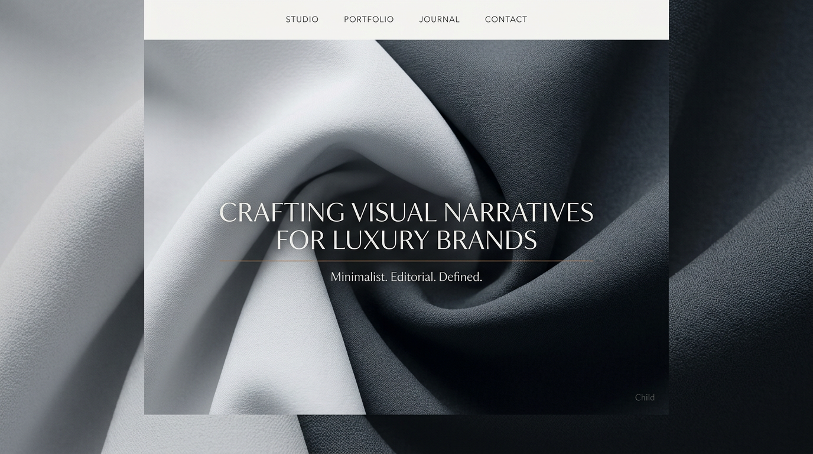

# Atelier Noir

**A free, open-source luxury editorial WordPress theme for creative studios, fashion houses and art directors.**

[](https://github.com/wilfread237/atelier-noir/releases/latest)
[](https://github.com/wilfread237/atelier-noir/actions/workflows/ci.yml)
[](LICENSE)



- **Download:** [atelier-noir.zip](https://github.com/wilfread237/atelier-noir/releases/latest/download/atelier-noir.zip) (theme + companion plugin). The zip is published when a `v*` tag matches `Version` in `style.css`. Until that first release, clone the repository.
- **Live demo:** [atelier-noir.42web.io](https://atelier-noir.42web.io/)

---

## The story

Atelier Noir started as a bespoke site for a creative studio working in fashion and art direction. The brief was simple and demanding: the website had to feel like the studio's work — quiet, confident, cinematic — and get out of the way of the images.

Once the project was delivered, I rebuilt it from the ground up as a generic theme, removed every piece of client content, and released it for free so that other studios, photographers and independent designers can start from the same foundation.

### Inspirations

The visual language borrows from the codes of high-end fashion and event design: full-bleed video, black and white with a single warm accent, oversized uppercase typography, generous negative space and slow, deliberate transitions. Two references shaped the direction in particular:

- **Bureau Betak** — the way a studio portfolio can feel like a stage, with projects presented as full-screen moments.
- **Saint Laurent (ysl.com)** — the restraint of the navigation, the editorial typography and the black-and-white rhythm.

> Atelier Noir is an independent project. It is not affiliated with, endorsed by or sponsored by Bureau Betak or Saint Laurent. Their names are cited only as design inspirations; all trademarks belong to their respective owners. The theme contains none of their assets.

---

## Features

- **Home**: black field, centered white type, one dark-orange line, and two actions — Start project and Explore services. “Made in Douala” stays on the home header.
- **Header**: the `atelier` / `noir.` wordmark and the menu icon on every page. On the legal pages the wordmark and the icon turn black.
- **Services**: full-screen slides, titles in lowercase, a photograph behind each service, and a call to action toward contact.
- **Projects**: a project post type. Each project is a stack of full-screen images. A caption can sit on an image. The title is for the admin and the project URL.
- **Contact**: lowercase studio details and the same social icons as the footer.
- **Footer**: navigation, information, and a Theme author column (LinkedIn, email, Instagram, TikTok).
- **Sharing**: Open Graph and Twitter cards (title `atelier noir`, a studio description, a bundled preview image) and a wordmark favicon.
- **Legal pages**: legal notice, privacy policy and terms, on a light field.
- **Menu overlay** and **page loader** with Customizer controls.
- **Optional WooCommerce shop**, off until you install WooCommerce and enable **Customize → Atelier Noir — Commerce**. Styled to match, with branded emails.
- **Newsletter** footer form and popup via MailPoet, with explicit consent (hidden when MailPoet is not installed).
- **Setup page** (**Appearance → Atelier Noir Setup**): plugin checklist and one-click demo content.
- **Open-source typography**, self-hosted: [Outfit](https://fonts.google.com/specimen/Outfit) for headings, [Inter](https://fonts.google.com/specimen/Inter) for body text (SIL Open Font License).
- Translation-ready, PHP 7.4+, no build step.

## Requirements

- WordPress 6.3 or later, PHP 7.4 or later
- Parent theme: [Hello Elementor](https://wordpress.org/themes/hello-elementor/) (free)
- Recommended: [Elementor](https://wordpress.org/plugins/elementor/) (free), [WooCommerce](https://wordpress.org/plugins/woocommerce/) for the shop, [MailPoet](https://wordpress.org/plugins/mailpoet/) for the newsletter

## Installation

1. Install and activate **Hello Elementor** (**Appearance → Themes → Add New**).
2. Download [atelier-noir.zip](https://github.com/wilfread237/atelier-noir/releases/latest/download/atelier-noir.zip) and upload it in **Appearance → Themes → Add New → Upload Theme**.
3. Activate **Atelier Noir**.
4. Open **Appearance → Atelier Noir Setup**:
   - click **Install** next to **Atelier Noir Core** — the companion plugin is shipped inside the theme zip;
   - install Elementor (and WooCommerce if you need a shop);
   - click **Install demo content**.
5. Replace the demo texts, images and videos in **Appearance → Customize**.

### Why a companion plugin?

WordPress guidelines keep themes about presentation. Everything that should survive a theme switch — the projects post type, Open Graph tags, the newsletter, the demo importer and the WooCommerce extras — lives in **Atelier Noir Core**. The theme works without it; you just lose those features.

## Customizing the theme

Be clear on what you get before you start:

| What | Where you edit it |
| --- | --- |
| Colors, typography, logo, display mode | **Customize → Atelier Noir — …** sections |
| Home headline, accent line and buttons | `template-parts/home-landing.php` and **Customize → Atelier Noir — Home** |
| Services slides, contact page, legal pages | **Customize → Atelier Noir — Services / Contact / Legal** |
| Header, menu overlay, footer, loader | **Customize → Atelier Noir — Menu overlay / Footer / Loader** |
| Demo pages built with Elementor | Elementor editor (free version, drag and drop) |

The signature templates — Home, Services, Contact, Projects, legal pages, loader, header and footer — are **hand-written PHP templates driven by the Customizer**. This is a deliberate choice: it keeps the pages fast, keeps the editorial look consistent, and works without any page builder licence. You change the content, not the layout.

The pages created by the demo importer only use **free Elementor widgets**, so they can be edited with drag and drop in Elementor (free).

What the theme does **not** do: rebuild the header, footer or signature templates visually. That requires **Elementor Pro's Theme Builder**, which is not included.

### Custom work

Need your own layouts, a migration of the signature templates to Elementor Pro Theme Builder, or new features? [Request a quote](https://www.linkedin.com/in/wilfreadessomba/).

## Video URLs

Use **direct file links** (`.mp4`, `.webm`, `.mov`) or YouTube links. HTML gallery pages (e.g. Pexels watch URLs) are not supported. For best performance, host large videos on a CDN or video platform rather than in the media library.

## Development

```bash
git clone https://github.com/wilfread237/atelier-noir.git wp-content/themes/atelier-noir
ln -s ../themes/atelier-noir/plugins/atelier-noir-core wp-content/plugins/atelier-noir-core
cd wp-content/themes/atelier-noir
composer install
composer test:unit
```

- `plugins/atelier-noir-core/` — companion plugin source
- `bin/build-release.sh` — builds `dist/atelier-noir.zip` (with the plugin in `bundled/`) and `dist/atelier-noir-core.zip`
- Pushing a `v*` tag matching the `Version` in `style.css` runs the tests and publishes a GitHub release with both zips.

Contributions are welcome — read [CONTRIBUTING.md](CONTRIBUTING.md). Security issues: see [SECURITY.md](SECURITY.md).

## License

Atelier Noir and Atelier Noir Core are free software, released under the [GNU General Public License v3 or later](LICENSE). Hello Elementor is GPL-licensed by Elementor Ltd. Outfit and Inter are distributed under the SIL Open Font License 1.1 (see `assets/fonts/OFL-*.txt`).

## Author

Designed and developed by **Wilfread Essomba** — [LinkedIn](https://www.linkedin.com/in/wilfreadessomba/) · [Instagram](https://www.instagram.com/wilfreadessomba) · [TikTok](https://www.tiktok.com/@with_ead) · wilfreadessomba@gmail.com.

If the theme helps you, a ⭐ on GitHub is the best way to say thanks.
